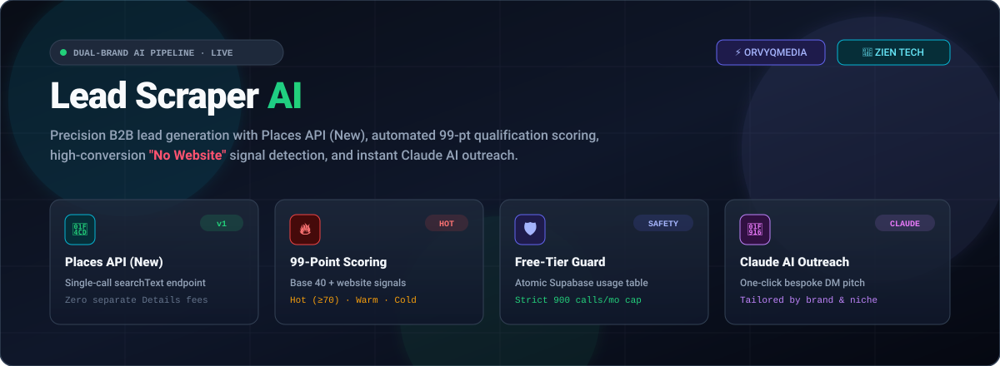
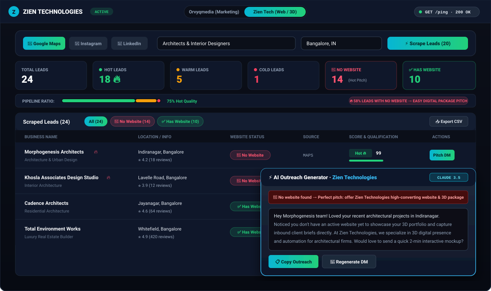
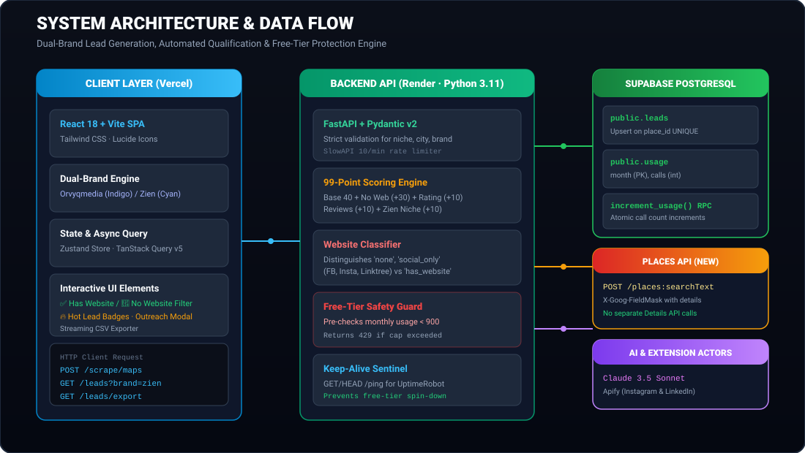
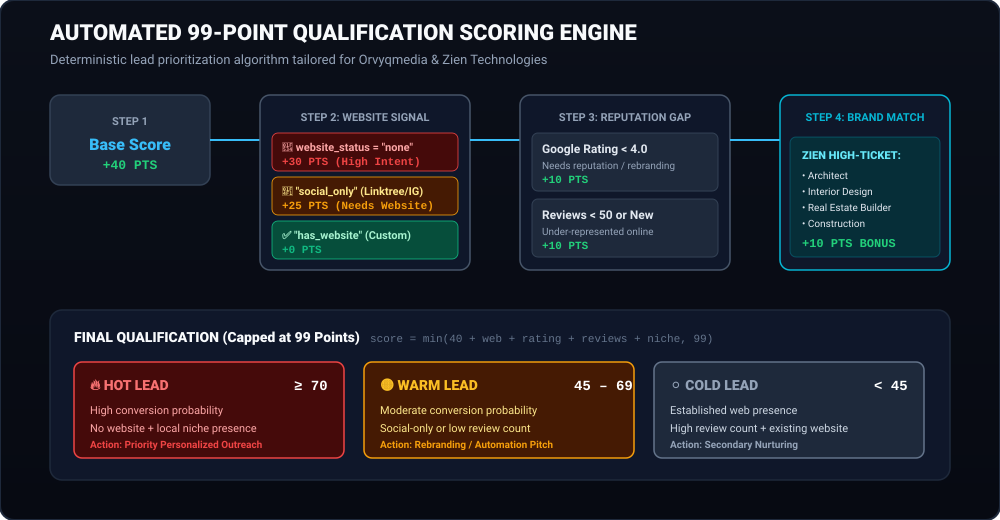
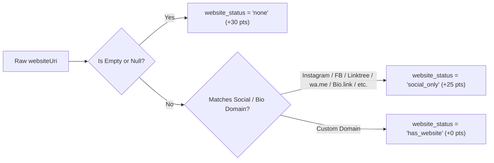

# Lead Scraper AI · Dual-Brand B2B Pipeline

<div align="center">



[](https://python.org)
[](https://fastapi.tiangolo.com)
[](https://react.dev)
[](https://vitejs.dev)
[](https://supabase.com)
[](https://tailwindcss.com)
[](https://lead-scraper-api-bqt4.onrender.com)
[](./LICENSE)

**Automated business discovery, 99-point qualification scoring, and AI-powered personalized outreach.**  
Built for dual-brand agency operations: **Orvyqmedia** (Marketing) and **Zien Technologies** (Web, Automation & 3D).

[Live API Endpoint](https://lead-scraper-api-bqt4.onrender.com) · [API Documentation (Swagger)](https://lead-scraper-api-bqt4.onrender.com/docs) · [Report Bug](https://github.com/ekanth14/lead-scraper/issues)

</div>

---

## 📸 Visual Dashboard Showcase

The Lead Scraper UI is an ultra-fast, dark-themed responsive dashboard built with React 18, Tailwind CSS, TanStack Query, and Zustand. It allows switching brands in one click, filtering high-value targets, and drafting bespoke outreach.

<div align="center">



</div>

### UI Highlights
* **Brand Context Switcher**: Seamlessly toggles theme accents, pitch templates, and industry qualification bonuses between **Orvyqmedia** (`orv`) and **Zien Technologies** (`zien`).
* **Visual Website Qualification Chips**:
  * `✅ Has Website` (Emerald green badge, clickable directly to target site).
  * `🔴 No Website` (High-contrast crimson badge with `🔥` flame indicator for instant pitch targeting).
* **Interactive Website Filter Row**: Toggle between `[ All ]`, `[ 🔴 No Website ]`, and `[ ✅ Has Website ]` with live lead counts.
* **Pipeline Distribution Meter**: Visual multi-segment health gauge showing real-time distribution of Hot, Warm, and Cold leads, alongside high-converting No-Website pitch ratios.
* **One-Click Claude AI Outreach Modal**: Generates personalized cold DMs specifically tailored to the target's niche, online reputation, and missing website status.

---

## 🏛️ System Architecture

<div align="center">



</div>

The application consists of a decoupled client-server architecture deployed on **Render** (FastAPI backend) and **Vercel** (React SPA frontend), integrated with **Supabase PostgreSQL** and **Google Places API (New)**.

### Architectural Pillars
1. **Google Places API (New)**: Uses `POST https://places.googleapis.com/v1/places:searchText` with `X-Goog-FieldMask`. A single call retrieves the business display name, formatted address, rating, review counts, website URI, national phone number, place types, and Google Maps URI without executing separate, costly Details API requests.
2. **Deterministic Qualification Engine**: Every lead is scored against a 99-point rubric factoring in digital presence gaps, review density, reputation, and brand-specific target industries.
3. **Atomic Free-Tier Guard**: Prevents unexpected cloud bills by enforcing a strict **900 request/month cap** tracked in a dedicated Supabase `usage` table via a PostgreSQL atomic RPC function.
4. **24/7 Keepalive Sentinel**: Implements `@app.api_route("/ping", methods=["GET", "HEAD"])` pinged every 5 minutes by UptimeRobot to eliminate Render free-tier container sleep.

---

## 🧠 Lead Scoring Engine

The scoring engine prioritizes businesses with the highest probability of needing web development, rebranding, or marketing services.

<div align="center">



</div>

### Scoring Rules (`services/scoring.py`)

$$\text{Lead Score} = \min\big(40 + S_{\text{website}} + S_{\text{rating}} + S_{\text{reviews}} + S_{\text{niche}},\, 99\big)$$

| Signal | Criteria | Points | Rationale |
| :--- | :--- | :---: | :--- |
| **Base Score** | All valid places | **+40** | Initial baseline score for qualified local businesses. |
| **No Website** | `websiteUri` is empty / null | **+30** | 🔥 **High-Value Pitch Target**: Ideal customer for Zien or Orvyqmedia. |
| **Social / Bio Link** | Domain is Instagram, FB, Linktree, `wa.me`, etc. | **+25** | Active digital marketing presence, but lacks an authoritative custom website. |
| **Low Google Rating** | `rating < 4.0` | **+10** | Needs reputation management, customer review strategy, or rebranding. |
| **Low Review Volume** | `reviews < 50` or unreviewed | **+10** | Under-indexed on local SEO and Google Maps rankings. |
| **Zien Target Niche** | Brand is `zien` & niche contains *architect*, *interior*, *real estate*, or *construction* | **+10** | High-ticket potential for custom web design, automation, and 3D architectural rendering. |

### Qualification Tiers
* **🔥 Hot Lead (`score >= 70`)**: Highest outreach priority. Missing a website or relying solely on social media within high-ticket niches.
* **🟡 Warm Lead (`45 <= score < 70`)**: Established business with partial online presence or low review counts.
* **⚪ Cold Lead (`score < 45`)**: High review count, 4.8+ rating, and existing established custom website.

---

## 🌐 Website Classification Matrix

The scraper inspects the `websiteUri` and classifies it into three explicit statuses:



* **`"none"`**: Business has no website listed on Google Maps.
* **`"social_only"`**: Business links to `facebook.com`, `instagram.com`, `linktr.ee`, `wa.me`, `bio.link`, `beacons.ai`, `taplink.cc`, etc.
* **`"has_website"`**: Business has a legitimate custom domain (e.g., `https://example-architects.in`).

---

## 🛡️ Free-Tier Safety Guard

To prevent unexpected Google Cloud billing, the backend integrates an atomic usage sentinel backed by Supabase:

1. Before making any outbound request to Google Places API, the server queries the `usage` table for the current month (`YYYY-MM`).
2. If `calls >= 900`, the server terminates the request immediately and returns:
   ```json
   {
     "detail": "Monthly Google Places API limit reached (900 calls). Free tier cap enforced. Never calling Google past 900. Resets next month."
   }
   ```
   **HTTP Status**: `429 Too Many Requests`.
3. For every successful Google Places page request, the server executes the PostgreSQL RPC `increment_usage(p_month, p_count)` to atomically update the counter.

---

## 🔌 API Endpoints

### 1. Scrape Google Places (New)
```http
POST /scrape/maps
Content-Type: application/json

{
  "niche": "architect",
  "city": "Bangalore",
  "brand": "zien",
  "max_results": 20
}
```
**Response**:
```json
{
  "leads": [
    {
      "place_id": "ChIJb8vJ12345678",
      "brand": "zien",
      "niche": "architect",
      "name": "Studio Morph Architects",
      "address": "Indiranagar, Bangalore, Karnataka 560038",
      "phone": "+91 80 2520 1234",
      "website": null,
      "website_status": "none",
      "rating": 4.1,
      "reviews": 16,
      "score": 99,
      "label": "hot",
      "why": "No website (+30), Reviews 16 < 50 (+10), Target industry for Zien (+10)",
      "maps_url": "https://maps.google.com/?cid=123456789"
    }
  ],
  "count": 20,
  "brand": "zien",
  "source": "maps",
  "requests_made": 1
}
```

### 2. List Leads (Filtered & Paginated)
```http
GET /leads?brand=zien&website_status=none&label=hot&limit=50&offset=0
```

### 3. Stream CSV Export
```http
GET /leads/export?brand=zien&website_status=none
```
Downloads `leads-zien-YYYY-MM-DD.csv` including `name`, `brand`, `niche`, `score`, `label`, `website_status`, `website`, `phone`, `rating`, `reviews`, `address`, `why`, `maps_url`.

### 4. Health & Sentinel Keepalive
```http
GET /ping
HEAD /ping
```
**Response**: `{"pong": true}` (Status 200).

---

## 🚀 Quickstart & Local Installation

### Prerequisites
* Python 3.11+
* Node.js 18+ & npm
* Supabase Account & Google Maps API Key

### 1. Clone Repository
```bash
git clone https://github.com/ekanth14/lead-scraper.git
cd lead-scraper
```

### 2. Backend Setup
```bash
cd backend
python -m venv .venv

# Activate Virtualenv (Windows)
.venv\Scripts\activate
# Activate Virtualenv (macOS/Linux)
source .venv/bin/activate

pip install -r requirements.txt
cp .env.example .env
```

Configure your `backend/.env`:
```env
GOOGLE_MAPS_API_KEY=AIzaSy...
SUPABASE_URL=https://your-project.supabase.co
SUPABASE_KEY=your-supabase-key
FRONTEND_URL=http://localhost:5173
```

Run database setup:
* Copy the contents of [`backend/supabase_setup.sql`](./backend/supabase_setup.sql) and execute in your **Supabase SQL Editor**.

Start Backend Server:
```bash
uvicorn app.main:app --reload --port 8000
```

### 3. Frontend Setup
```bash
cd ../frontend
npm install
npm run dev
```
Open [http://localhost:5173](http://localhost:5173) in your browser.

---

## 📦 One-Click Startup Scripts

* **Windows**: Double-click `start.bat` or run `powershell -ExecutionPolicy Bypass -File start.ps1`.
* **macOS / Linux**: Run `bash start.sh`.

---

## 🗄️ Supabase Schema Overview

```sql
-- Free-Tier Usage Guard
CREATE TABLE usage (
    month text PRIMARY KEY,
    calls integer NOT NULL DEFAULT 0
);

-- Leads Storage
CREATE TABLE leads (
    id uuid PRIMARY KEY DEFAULT gen_random_uuid(),
    place_id text UNIQUE NOT NULL,
    brand text NOT NULL,              -- 'orv' or 'zien'
    niche text,
    name text NOT NULL,
    address text,
    phone text,
    website text,
    website_status text NOT NULL DEFAULT 'none',  -- 'none', 'social_only', 'has_website'
    rating numeric,
    reviews integer,
    score integer NOT NULL DEFAULT 40,
    label text NOT NULL DEFAULT 'cold',           -- 'hot', 'warm', 'cold'
    why text,
    maps_url text,
    source text DEFAULT 'maps',
    created_at timestamptz DEFAULT now()
);

-- Fast Indexing
CREATE INDEX idx_leads_place_id ON leads(place_id);
CREATE INDEX idx_leads_brand ON leads(brand);
CREATE INDEX idx_leads_website_status ON leads(website_status);
CREATE INDEX idx_leads_label ON leads(label);
CREATE INDEX idx_leads_score ON leads(score DESC);
```

---

## 📄 License
This project is open-source and licensed under the [MIT License](./LICENSE).

---

<div align="center">
  <sub>Engineered by Zien Technologies &amp; Orvyqmedia · Production-Ready Lead Intelligence</sub>
</div>
